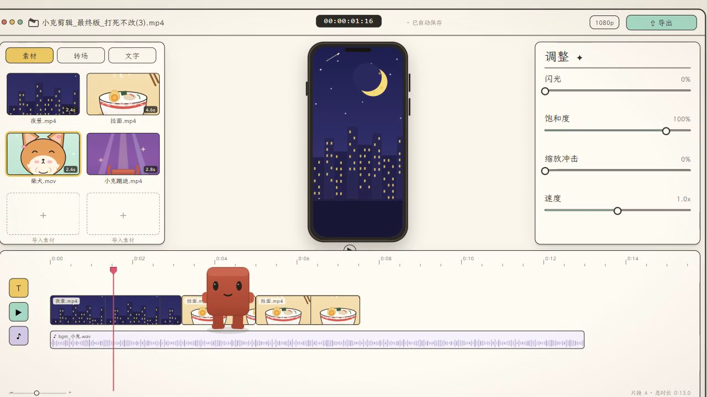

# Opus Edit Motion — 30s Remotion Recreation



▶ **[Watch the 30s render](preview/opus-edit.mp4)**

A frame-by-frame recreation of a hand-drawn, screen-recording-style motion piece:
**"Claude edits a 30-second video"**. The whole 30 seconds is built in Remotion with
React + SVG — no screen capture, no stock footage, no bitmap assets (only fonts).

> 视频被完整拆解成 11 个镜头：终端启动 → 素材入库 → 时间轴删除 → 转场 → 花字 →
> Ctrl+Z 修正 → 调色拉满 → 卡点 → 导出渲染 → 便利贴收工。全部由代码绘制。

## Preview

- Composition: `OpusEdit` — 1280×720, 30 fps, 900 frames (30.0 s)
- Rendered file after `npm run render`: `out/opus-edit.mp4`

## Quick start

```bash
npm install
npm run dev      # Remotion Studio at http://localhost:3000
npm run render   # -> out/opus-edit.mp4
npm run still    # -> out/still.png (frame 0 by default)
npm run typecheck
```

Render a single frame for inspection:

```bash
npx remotion still OpusEdit out/frame-480.png --frame=480
```

## Design breakdown

| Layer | What it does |
| --- | --- |
| `src/Video.tsx` | Master timeline: playhead, clip reveal, camera keyframes, annotation beats, ending card |
| `src/components/Editor.tsx` | The fake NLE: title bar, media bin, transitions, text presets, phone preview, adjustment sliders, timeline, waveform, trash, export button |
| `src/components/Mascot.tsx` | "小克" — the red square character, with poses (idle/happy/shades/dance/sleep) and the rubber arm |
| `src/art/Scenes.tsx` | Four hand-drawn SVG scenes reused as phone preview and timeline thumbnails: night city, ramen, shiba, disco |
| `src/components/Sketch.tsx` | Sketch UI kit: frames, tape, speech bubbles, keycaps, stamps, outlined display type, sparkles |
| `src/fonts.tsx` | Font loading with `delayRender` / `continueRender` so no frame renders before the fonts land |

### Palette

- paper `#F5F0E5`, panel `#FFFCF4`, ink `#312E28`
- mascot red `#C25A44`, mint `#A9DDC9`, yellow `#F1CD66`, lavender `#D7CFEB`, pink `#F4CBD3`
- night `#28295B` / `#453A78`, window glow `#F6DA6F`

### Motion language

- The editor is a single world that the "camera" pushes into (timeline at 5 s,左右面板 at 7 s,
  right panel + phone at 15 s) instead of cutting between full-screen layouts.
- Rubber arms stretch from the mascot to whatever control it is touching (sliders, trash,
  export button) — one continuous, readable action per beat.
- Annotations are screen-space (they do not zoom with the UI), which keeps the gags legible.
- Everything is deterministic and seek-safe: no `Math.random()` in render, all motion derives
  from `useCurrentFrame()`.

## Audio

`public/audio/bgm.wav` is **generated procedurally** by `scripts/make-audio.mjs` (pure Node,
no dependencies): a 96 BPM lo-fi loop plus typing, whoosh, metal clang, pops, slider riser and
an export chime, all placed to the frame timings in the video. Regenerate with:

```bash
node scripts/make-audio.mjs
```

## Fonts

Subsetted to the glyphs used in the piece, all under the SIL Open Font License:

- **LXGW WenKai** (霞鹜文楷) — body / UI, Regular + Medium
- **ZCOOL KuaiLe** (站酷快乐体) — display type
- **Caveat** — handwritten "Opus 5.5"

See `public/fonts/README.md` for attribution.

## Notes

This is an original code recreation of the composition and pacing of a reference recording.
No frame, texture or audio from the reference is redistributed here.
